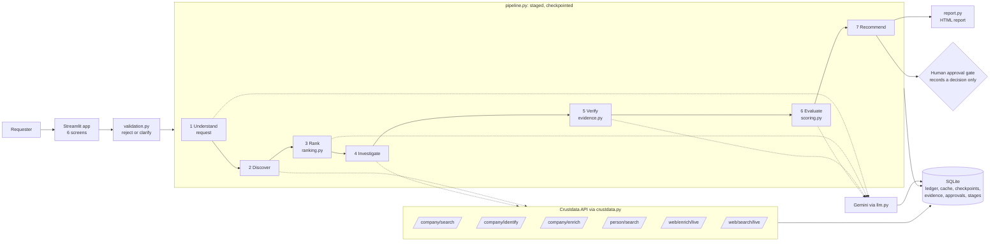

# PartnerScout

**An agent that finds, investigates, verifies and ranks strategic business partners, checks each one for competitive conflict, explains what each side would gain, and drafts the first message. A person approves; nothing is sent automatically.**

ContextCon 05 (BITS Pilani x Crustdata), theme *Services, Replaced*. Primary theme **Revenue**, with **Research and markets** and **Trust and compliance**.

| | |
|---|---|
| **Live demo** (read-only, real saved runs, no keys needed) | [partnerscout.streamlit.app](https://partnerscout.streamlit.app/) |
| Diagrams (one draw.io page, technical + business) | [open and edit](https://app.diagrams.net/#Uhttps%3A%2F%2Fraw.githubusercontent.com%2FJakkiRajasekharRamana%2FCrustdata%2Fmain%2Fdocs%2Fdiagrams%2Fpartnerscout-architecture.drawio) |
| Sample deliverable | [docs/sample_report.html](docs/sample_report.html) (run `demo6`) |
| Engineering audit (what was found and fixed, with measurements) | [docs/engineering-audit.md](docs/engineering-audit.md) |
| Architecture (Mermaid) | [docs/architecture.md](docs/architecture.md) |

## Contents

1. [The service](#1-the-service) 2. [What it does now, and where a person is needed](#2-what-it-does-now-and-where-a-person-is-needed) 3. [Run it from a fresh clone](#3-run-it-from-a-fresh-clone) 4. [Verify the claims yourself](#4-verify-the-claims-yourself) 5. [Architecture](#5-architecture) 6. [Crustdata integration and the cost ledger](#6-crustdata-integration-and-the-cost-ledger) 7. [Model integration](#7-model-integration) 8. [Pipeline, stage by stage](#8-pipeline-stage-by-stage) 9. [Evidence and verification](#9-evidence-and-verification) 10. [Scoring and recommendation rules](#10-scoring-and-recommendation-rules) 11. [Reliability, recovery and safety](#11-reliability-recovery-and-safety) 12. [Data model](#12-data-model) 13. [Interface](#13-interface) 14. [Evaluation](#14-evaluation) 15. [Test cases](#15-test-cases) 16. [Approaches tried](#16-approaches-tried) 17. [Hardest case and who it can get wrong](#17-hardest-case-and-who-it-can-get-wrong) 18. [What was left out, and what comes next](#18-what-was-left-out-and-what-comes-next) 19. [Repository layout](#19-repository-layout) 20. [Declaration](#20-declaration)

---

## 1. The service

**Service replaced:** strategic partnership research: finding, vetting and prioritising channel, reseller and technology partners.

**Who does it today:** partnerships and corporate-development teams, business-development agencies and strategy consultancies. An analyst searches directories, reads company sites and news, builds a spreadsheet, drafts outreach, and writes a recommendation.

**Who pays:** B2B SaaS and technology companies entering a new industry or country, directly or through an agency.

**The job PartnerScout completes:** one request in ("a cybersecurity SaaS company expanding distribution in India's banking sector, find five channel or technology partners..."), one decision-ready brief out: ranked partners, quote-checked evidence, a competitive-conflict check, a mutual-value analysis, the decision-maker taken from the data record, and a draft first message, each with its sources.

It is deliberately **not** a lead-generation tool. Lead tools answer "who could buy?". PartnerScout answers "which relationships are worth pursuing, why would they work for **both** sides, and what could make them a bad idea?".

### Business case (all figures are our assumptions, not validated with a customer)

* **Buyer:** a partnerships, business-development or strategy lead; secondary buyer, agencies serving several such clients.
* **Today:** days to weeks of analyst time per shortlist (our estimate; no buyer was interviewed).
* **Proposed price:** about Rs 4,000 per brief (up to 5 vetted partners), or about Rs 25,000 a month for 10 briefs.
* **Cost of one job, measured on a cold-cache run (`demo3`, 6 companies investigated):** 24.8 Crustdata credits and 80,760 model tokens (53,108 in, 27,652 out), about US$0.085 at an assumed list price of US$0.30 / US$2.50 per million input / output tokens (the free tier billed US$0). About 10 minutes, limited by the key's 5 requests per minute on company endpoints.
* **What is not claimed:** a gross margin. Crustdata's price per credit and hosting cost are unknown to us, so only credits and model cost are measured. The ledger reconciles with the account balance (section 6).

---

## 2. What it does now, and where a person is needed

| Step of the job | Done by the product | A person is needed when |
|---|---|---|
| Understand the request | Parses free text into a structured brief; rejects invalid requests before any paid call | The brief lists things to confirm (for example the exact product niche) |
| Find candidates | Three ranked company searches, duplicates collapsed, 73 to 75 unique candidates per run | Never |
| Choose whom to investigate | Deterministic code-computed ranking plus categorical model judgements | Never; the shortlist size is a setting |
| Check identity | Resolves each company, checks match confidence and domain | A company is unresolved or its sources disagree: it is flagged for manual review |
| Gather evidence | Crustdata record, the company's own site, news and adverse-media search | A tool fails: the company is **held for review**, never read as "no evidence" |
| Verify claims | Every claim needs a verbatim quote that exists in its source; sources are classified | A claim cannot be verified: it says "I can't verify this from the available sources" |
| Judge fit and conflict | 5-part fit score, conflict penalty, relationship dimensions, mutual value | A verified direct competitor or a namesake conflict forces manual review |
| Name the decision-maker | Taken from the Crustdata record; Person Search only if the record lists none | None found: stays unverified |
| Draft outreach | Draft subject and body, labelled DRAFT | **A person approves every draft.** Approving records the decision; there is no send step |
| Track partners | Pipeline stages and an ecosystem map | A person sets Outreach Drafted and Archived |

---

## 3. Run it from a fresh clone

Tested with Python 3.14 on Windows; the code needs Python 3.10 or newer (`str | None` annotations). Streamlit is pinned to 1.58.0 because the UI uses APIs scheduled for removal in later versions.

```bash
git clone https://github.com/JakkiRajasekharRamana/Crustdata.git
cd Crustdata
python -m venv .venv
.venv\Scripts\activate            # Linux/macOS: source .venv/bin/activate
pip install -r requirements.txt
```

### Mode A: no keys needed (read-only demo of saved real runs)

Hosted at https://partnerscout.streamlit.app/ (Streamlit Community Cloud, no secrets set, so it opens this mode). Locally:

```bash
streamlit run app.py
```

With no `CRUSTDATA_API_KEY` and no `PARTNERSCOUT_DB` set, the app opens the committed snapshot `demo_data/demo.db` (runs `demo1` to `demo4`, `demo6`, `demo-crash`), copied to a temporary file. New runs are disabled. Force this mode with `PARTNERSCOUT_DEMO=1`. All verification scripts in section 4 work in this mode.

### Mode B: live runs

```bash
copy .env.example .env             # Linux/macOS: cp .env.example .env
# fill CRUSTDATA_API_KEY and GEMINI_API_KEY
python pipeline.py --run-id live1                  # runs the sample request
python report.py live1                             # writes out/live1.html
streamlit run app.py                               # the UI
```

### Environment variables

| Variable | Default | Meaning |
|---|---|---|
| `CRUSTDATA_API_KEY` | required for live runs | Bearer token for `api.crustdata.com` |
| `GEMINI_API_KEY` | required for live runs | Key for the Gemini REST API |
| `RUN_CREDIT_CEILING` | 300 | Credits one run may spend; checked before every call |
| `RUN_TIME_CEILING_SECONDS` | 900 in code, 2400 in `.env.example` | Wall-clock limit of one run |
| `PARTNERSCOUT_DB` | `./data/partnerscout.db` | Location of the SQLite file (keep it outside synced folders) |
| `PARTNERSCOUT_DEMO` | unset | `1` forces the read-only snapshot |
| `GEMINI_MODEL`, `GEMINI_FALLBACK_MODEL` | `gemini-3.8-flash`, `gemini-3.5-flash` | First two models of the rotation |

### CLI (`pipeline.py`)

| Flag | Meaning |
|---|---|
| `--request TEXT` | The request (defaults to the sample request in `DEMO_REQUEST`) |
| `--run-id ID` | Run identifier. **Re-running the same id resumes** from the last checkpoint |
| `--credit-ceiling N` | Override the credit ceiling for this run |
| `--shortlist N` | Companies to investigate (default 6) |
| `--crash-after STAGE` | Kill the process after `brief`, `discover`, `screen`, `identity`, `enrich`, `research` or `claims` (recovery demo) |
| `--simulate-failure enrich` | Make the first company's enrichment fail once (held-for-review demo) |

Exit codes: `0` finished, `2` stopped and resumable (simulated crash, ceiling reached, or out of credits), `3` request rejected by validation.

```bash
python pipeline.py --run-id r1 --crash-after enrich        # dies after the first company's enrichment
python pipeline.py --run-id r1                             # resumes; finished stages are not repeated
python pipeline.py --run-id r2 --simulate-failure enrich   # first company is held for review
python pipeline.py --run-id r2                             # retries only the held company
python -m pytest -q tests                                  # offline tests
```

---

## 4. Verify the claims yourself

All of these run offline against the committed snapshot (set `PARTNERSCOUT_DEMO=1` if you also have keys in `.env`), except where marked live.

| Check | Command | Expected |
|---|---|---|
| Unit and fault-injection tests | `python -m pytest -q tests` | `59 passed` |
| Per-run measurements (identity, duplicates, claims, coverage, citations, decision-makers, credits, calls) | `python scripts/evaluate_run.py demo6` | table; `demo6`: 82 claims, 78 verified, 78/80 = 98% coverage, 73/73 citations valid, 0 duplicates |
| No paid request was repeated (exactly-once) | `python scripts/check_repeated_paid_calls.py demo3` (also `demo6`, `demo-crash`) | `identical paid requests repeated: 0` |
| Ranking stability summary | `python scripts/summarize_ranking_stability.py after_final` (also `before`, `after_a+after_b`) | before: 73% top-6 overlap; after: 100% |
| Sample verified claims next to their quotes, for human judgement | `python scripts/sample_claims_for_review.py demo3 15` | 15 claims with quotes |
| Run state and last ledger rows | `python scripts/run_status.py demo6` | status, last calls, totals |
| One company's full result | `python scripts/show_result.py demo3 Finonyx` | scores, flags, claims |
| Credit ledger against the account balance (**live**, free call) | `python scripts/reconcile_credit_ledger.py 15200` | difference within 0.13 (explained in section 6) |
| Ranking experiment (**live**, model calls) | `python scripts/measure_ranking_stability.py demo3 10 mylabel` then `python scripts/summarize_ranking_stability.py mylabel` | top-6 overlap 100% on a fixed pool |
| Decision-maker coverage (**live**, 0.13 credits per lookup) | `python scripts/measure_decision_maker_coverage.py demo1 demo2 demo3 demo4` | 17/24 before and after the fallback |
| Re-classify sources and recompute confidence (**live**, one request per Google redirect link) | `python scripts/reclassify_sources.py demo3` | confidence changes listed |
| Rebuild evidence rows from saved results | `python scripts/restore_evidence_from_results.py` | rows restored per run |
| Regenerate the demo snapshot | `python scripts/export_demo_snapshot.py demo1 demo2 demo3 demo4 demo6 demo-crash` | `demo_data/demo.db` |

Raw experiment output is in [evaluation_results/](evaluation_results/).

---

## 5. Architecture



Both diagrams (technical and business) are on one editable draw.io page; the link is at the top.

**Process model.** The Streamlit UI never runs the pipeline in-process. It starts `pipeline.py` as a subprocess and reads SQLite, so a crash cannot take the UI down and any run can be resumed by id. SQLite runs in WAL mode with a 30 s busy timeout and one process-wide lock around writes.

**Agents.** One orchestrator and five roles, implemented as prompted functions over one shared model: Partner Discovery, Company Intelligence, Trust and Verification, Strategic Fit, Partnership Strategist. They are separate functions with separate inputs and outputs, not five autonomous processes; section 16 says why.

**What runs where.** Python on a laptop or a small VM; SQLite file for all state; outbound HTTPS to Crustdata and Gemini; Leaflet and OpenStreetMap tiles are loaded by the browser for the maps. No queue, no vector store, no separate database server.

---

## 6. Crustdata integration and the cost ledger

Every Crustdata call goes through one class, `Crustdata.call` in `crustdata.py`. Nothing else in the repository calls Crustdata. Headers: `authorization: Bearer <key>`, `x-api-version: 2025-11-01`.

### Endpoints used

| Endpoint | Used for | Request shape (what we send) | Measured credits per call | Rate limit (key) | Mean latency |
|---|---|---|---:|---:|---:|
| `POST /company/search` | Discovery: ranked search, country filter | `{"limit":25,"search":{"query":...,"mode":"hybrid"},"filters":{"field":"locations.country","type":"=","value":"India"},"fields":[...]}` | 0.24 to 0.75 (0.03 per result) | 5/min | 4.6 s |
| `POST /company/identify` | Identity resolution | `{"domains":[...]}` | 0.2 | 5/min | 0.6 s |
| `POST /company/enrich` | Profile, headcount, funding, people | `{"domains":[...],"fields":["basic_info","headcount","funding","people"]}` | 2.0 | 5/min | 0.9 s |
| `POST /person/search` | Decision-maker fallback | `{"filters":{"field":"experience.employment_details.current.company_id","type":"=","value":<id>},"fields":["basic_profile.name","basic_profile.current_title","crustdata_person_id"],"limit":25}` | 0.13 for one result (0.03 base + 0.1 premium filter) | 5/min | 0.4 s |
| `POST /web/enrich/live` | The company's own website | `{"urls":["https://<domain>"]}` (max 10) | 1.0 per page | 10/min | 6.3 s |
| `POST /web/search/live` | Third-party and adverse-media search | `{"query":...,"sources":["news","web"]}` | 1.0 per page (up to 2.0) | 10/min | 9.0 s |
| `GET /account/endpoints` | Rate limits, read at start (free) | none | 0 | | |
| `GET /account/credits` | Balance (free) | none | 0 | | |

Credits and latencies are measured from the ledger (non-cached, status 200, all committed runs). Rate limits are read from `/account/endpoints` at start-up and override the defaults in `DEFAULT_RPM`. The person-search filter field was taken from the API's own error message that lists supported fields, not guessed.

### Client behaviour

| Condition | What the client does |
|---|---|
| Cached request (same path and body) | Returns the stored response, writes a ledger row with `cached=1`, `credits=0`. Cache key is `sha256(path + canonical JSON body)` |
| Before every attempt | Checks the run's credit ceiling and time ceiling; raises `BudgetExceeded` (run status `paused_budget`, resumable) |
| Rate limit | Sliding 60-second window per endpoint, sleeping until a slot is free |
| 200 with a JSON body | Logs the call with the credits from the `X-Credits-Used` header, caches the response |
| 200 with a non-JSON body | Logs it, does **not** cache it, backs off, retries (bounded) |
| 429 | Sleeps `x-ratelimit-reset` seconds (clamped to 1 to 60) and retries |
| 5xx or timeout | Exponential backoff `min(2^attempt, 20)` seconds |
| Attempts | At most 4 per call (`max_attempts`) |
| 402 | Fatal `CreditsExhausted` (run status `paused_credits`); retrying cannot help |
| 401, 403, other 4xx | Fatal `CrustdataError`, no retry |

A failure never means "the information does not exist": the caller marks the company held for review.

### Ledger

Table `calls`, one row per attempt, for Crustdata **and** model calls: `run_id, ts, service, endpoint, request_json, status, credits, cost_usd, latency_ms, cached, attempt, error`. Crustdata credits come from the response header. Model rows store input and output tokens in `request_json` and an estimated dollar cost in `cost_usd`.

**Reconciliation with the account balance.** Stated starting balance 15,200 credits. After all runs, `GET /account/credits` returned 15,073.66, so 126.34 credits were spent. The ledger sums to 126.21 over 162 Crustdata rows (31 cache hits at 0 credits, no non-200 rows with a cost). The 0.13 difference is one manual `/person/search` probe made outside the client while exploring the API.

**Per-run totals** (credits include every attempt):

| Run | Crustdata credits | Paid calls | Model rows | Estimated model cost | Note |
|---|---:|---:|---:|---:|---|
| `demo1` | 31.45 | 33 | 77 | $0.112 | first run, older code |
| `demo2` | 21.05 | 23 | 48 | $0.053 | |
| `demo3` | 24.80 | 23 | 87 | $0.085 | cold cache; the cost-per-job reference |
| `demo4` | 26.00 | 25 | 87 | $0.079 | |
| `demo6` | 11.53 | 11 | 92 | $0.106 | post-repair code; reused cached responses, so not a per-job cost |
| `demo-crash` | 15.65 | 13 | 27 | $0.022 | killed and resumed |

---

## 7. Model integration

All model calls go through `llm.ask_json(run_id, label, system, prompt, temperature, retries=8)` in `llm.py`. To change provider, only `_gemini()` has to be replaced.

* **Transport:** Gemini REST `generateContent`, `x-goog-api-key` header, `responseMimeType: application/json`, `systemInstruction` plus one user message.
* **Model rotation:** attempt *k* uses `MODELS[(k-1) mod 5]` = `gemini-3.8-flash`, `gemini-3.5-flash`, `gemini-3.1-flash-lite`, `gemini-flash-latest`, `gemini-3.6-flash`. On 429, 500 or 503 it sleeps `min(3 x attempt, 20)` s. Invalid JSON is retried. After 8 attempts it raises `LLMError`.
* **What actually served the calls:** the free tier overloaded the first two models during the runs. In `demo3` and `demo6` every successful call was served by `gemini-3.1-flash-lite`; 58 of 87 and 63 of 92 model ledger rows are failed attempts (overload) that were retried. This is why a run takes minutes and why model rows outnumber Crustdata rows.
* **Temperatures:** 0.0 for screening (so categorical judgements repeat); 0.1 elsewhere.
* **Median-of-3 assessment:** each company is assessed three times and the sample whose weighted score is the median is kept whole, so scores and their written reasons stay consistent. Spread is stored (`assessment_samples`).
* **Cost estimate:** `(input_tokens x 0.30 + output_tokens x 2.50) / 1e6` dollars, an assumed list price. The free tier billed $0.
* **What the model is and is not trusted with:** it proposes claims with quotes, categorical judgements, component scores and drafts. Code checks every quote, computes every score, applies every penalty and flag, and chooses the decision-maker only from the API record. Nothing the model says becomes a verified claim without a quote that exists in a retrieved source.

---

## 8. Pipeline, stage by stage

Stage outputs are checkpointed in `stages(run_id, stage, item, output_json)`. `stage()` runs a function once per `(run, stage, item)` and returns the stored output on later calls, which is what makes restarts exactly-once. Per-company stages use the Crustdata company id as `item`.

| # | Stage (`stage` name) | Input | What happens | Output |
|---|---|---|---|---|
| 0 | Validation | request text, optional structured fields | Deterministic checks (section 11); invalid requests stop here with no model or paid call | verdict |
| 1 | `brief` | request | One model call: requester offering, objective, target industry, country, partner types, required capabilities, three search queries, items to confirm | structured brief |
| 2 | `discover` | brief | Three `/company/search` calls, 25 results each, country filter. Duplicates collapse when the normalised domain **or** the normalised legal name matches (`norm_domain`, `norm_name` strip scheme, `www`, `pvt`, `ltd`, `limited`, `india`, `technologies`, `solutions`, `services` and punctuation) | 73 to 75 unique candidates |
| 3 | `screen` | candidates | `ranking.prescore` for every candidate in code; model returns categorical judgements in batches of 20 at temperature 0; `ranking.composite` combines them; deterministic order | ordered candidates |
| 4a | `identity` | domain | `/company/identify`; keeps match confidence, domain match, name match | identity record |
| 4b | `enrich` | domain | `/company/enrich` (`basic_info`, `headcount`, `funding`, `people`); people reduced to id, name, title | compact record |
| 4c | `people` | company id | Only if the record lists no decision-makers, founders or C-level people: `/person/search`, title filter | people list |
| 4d | `research` | company | Own website (`/web/enrich/live`, text truncated to 9,000 characters), and two `/web/search/live` queries (third-party, adverse), each keeping the first 6 hits; Google redirect links resolved to their destination | source corpus |
| 5 | `claims` | corpus | Model extracts up to 14 claims with verbatim quotes, up to 3 inferences, and conflicts with a quote from **each** side; code verifies every quote (section 9) | evidence rows |
| 6 | `assess` | claims | Median-of-3 assessment: four component scores with cited claim ids, competitive overlap, relationship dimensions, mutual value, partnership model, stakeholder, draft | assessment |
| 6 | `result` | assessment | `finalise`: drops citations to non-existent claims, computes trust, fit, confidence and flags, recommendation | company result |
| 7 | `final` | results | Ranks, totals the ledger, marks the run complete | final result, report |

Run status values: `running`, `complete`, `crashed` (simulated), `paused_budget`, `paused_credits`, `rejected`, `superseded`.

---

## 9. Evidence and verification

### Claim record (table `evidence`, key `(run_id, claim_id)`)

`claim_id, run_id, company_id, category, claim, source_url, source_ref, quote, published_at, retrieved_at, status, confidence, agent, notes, canonical_url, source_class, source_org, corroboration`.

Categories: `capability`, `bfsi_presence`, `distribution_channel`, `technology_integration`, `competing_product`, `leadership`, `adverse_media`, `identity`, `conflict`, `other`.

### Verification algorithm (`evidence.verify_quote`)

A claim is `verified` only if the model's quote, normalised by lower-casing and removing every character except `a-z0-9`, is at least 12 characters long and is a substring of the normalised text of the cited source. The normalisation makes the check robust to quote marks, dashes and whitespace and strict about words and numbers. Otherwise the claim is stored as `unverified` with the note "I can't verify this from the available sources". Model inferences are stored as `inferred`. A model's memory is never a source.

### Statuses

| Status | Meaning |
|---|---|
| `verified` | quote found in the cited source text |
| `unverified` | quote not found, or source not found |
| `inferred` | reasonable inference, no source states it |
| `contradicted` | two sources disagree about a **material** fact, each side backed by its own verified quote (hard manual-review flag) |
| `needs_review` | a minor discrepancy (for example founding year), shown, not blocking |

### What a verified quote does and does not prove

It proves the statement appears in the retrieved text. It does not prove the statement is true. So every source is classified, and the corroboration label says what the source can prove:

| Source class | Corroboration label | Counts as independent? |
|---|---|---|
| Crustdata API record (company-submitted fields in the data graph) | `api_record` | no |
| Company's own site | `self_reported` | no |
| Company's own LinkedIn page or posts | `self_reported` (class `company_social_profile`) | no |
| Regulator or government domain (`.gov.in`, `.nic.in`, `rbi.org.in`, `sebi.gov.in`, `irdai.gov.in`, `cert-in.org.in`, `mca.gov.in`) | `independent` | yes (strong) |
| Reputable news domain (an allow-list of 22 outlets) | `independent` | yes (strong) |
| Third-party business directory (tracxn, zaubacorp, justdial, instafinancials and similar) | `database_listing` | weak: counted once **per domain**, and two different domains are needed |
| Anything else | `weak` | no |

The class "verified partner or customer statement" is **never assigned by code**; confirming it needs a person.

### Canonical URLs

Search results come back as opaque Google `goto` links. `evidence.canonicalize` reads the redirect's `Location` header, follows at most 3 hops, only while the URL is still a Google link, never requests the destination page, rejects non-http(s) targets and strips tracking parameters. If it cannot resolve, the source is kept as "redirect link, destination could not be resolved" and classified `weak`. In a later pass 13 of 13 stored links resolved; at collection time in `demo6`, 3 of 6 did (Google answers intermittently).

### Pointing at the passage

In the report, every verified claim with an `http(s)` source gets a text-fragment link (`url#:~:text=<first words of the quote>`) so supporting browsers scroll to and highlight the passage. Claims taken from Crustdata fields show the field path (for example `basic_info.year_founded`) and the record id.

### Conflicts

A conflict is recorded only if both quotes verify in two different sources. Severity `material` (what the company is, who owns it, whether it operates, scale by an order of magnitude, whether it sells a competing product) becomes `contradicted`; `minor` becomes `needs_review`.

### Identity, duplicates and namesakes

* Identity: `/company/identify` on the domain; resolved when confidence is at least 0.95 and the domain matches. Confidence below 0.6 is a hard flag.
* One company under two names stays one record: duplicates collapse on normalised domain **or** normalised legal name.
* Namesakes: search snippets are only kept when they clearly refer to the candidate; when two sources describe different entities (an Indian IT firm and an Australian venture fund both called Airtree), the conflict is recorded with both quotes and the company goes to manual review.

---

## 10. Scoring and recommendation rules

All scoring is code (`scoring.py`, `ranking.py`), pure functions with unit tests. The weights are design assumptions, not validated values.

**Fit** = `0.30 Strategic + 0.25 Capability + 0.20 Market access + 0.15 Trust + 0.10 Feasibility`

* **Unknown is not zero.** A component the evidence cannot establish is left out and the remaining weights are renormalised; evidence confidence falls instead.
* **Conflict penalty**, taken off Strategic and shown: none 0, low 0, medium 8, high 20 points. A "high" overlap without a verified `competing_product` claim is downgraded to medium.
* **Trust** is computed, not modelled: start 70; +10 if identity confidence >= 0.95; +5 if active; +10 if the domain matches; -25 per verified adverse-media claim (max 2); -20 per contradiction (max 2); clamp 0 to 100; unknown if identity confidence < 0.6.
* **Market access** is capped at 70 by the prompt unless a non-self-reported claim shows named clients or channel reach.

**Evidence confidence** (separate from fit):

| Level | Rule |
|---|---|
| High | coverage >= 0.7 **and** `capability` and `bfsi_presence` both verified **and** at least 6 verified claims **and** (one regulator or news domain, or two different directory domains) |
| Medium | coverage >= 0.4 and at least 3 verified claims |
| Low | otherwise |

Coverage = verified / (verified + unverified + contradicted). Under this rule all 30 investigated companies in the five committed runs are Medium, because none has regulator or news corroboration. The label is a safe floor, not a ranking signal.

**Review flags** (hard flags override the score): identity unresolved; domain mismatch; contradictions between sources; medium or high competitive overlap; **verified direct competitor** (`competition_type = direct` with a verified `competing_product` claim); key claim (`bfsi_presence`) unverified.

**Recommendation** (`scoring.recommendation`, evaluated in this order):

1. fit unknown -> "Cannot rate - insufficient verified information"
2. any manual-review flag -> **Manual review before any approach**
3. competitive-conflict flag -> **Approach with caution - competitive overlap**
4. fit >= 70 and confidence High or Medium -> **Pursue**
5. fit >= 55 -> **Worth a conversation** (or "Promising but under-evidenced" when confidence is Low)
6. otherwise -> **Deprioritise**

**Candidate ranking** (`ranking.py`), computed for every candidate identically:

`prescore` = target-segment terms (up to 30) + capability terms (up to 35) + partner-type signals (up to 20) + size (0 to 10) + description present (5) - 40 if the name or the first 220 characters of the description match an exclusion term (association, media, investor, staffing, directory, physical or electronic security). Target terms come from the brief's target industry; capability terms from what the requester **sells**, with target-segment words removed so a fintech is not mistaken for a security vendor.

`composite` = `prescore` + serves-target (`yes` +15, `likely` +8, `unknown` 0, `no` -25) + competing product (`no` 0, `possible` -4, `yes` -10) + partner type (`channel` +8, `distribution` +8, `technology` +6, `consulting` +4, `not_a_partner` -60), clamped to 0 to 100. Order: composite descending, then Crustdata's own search position. The model's free-form 0 to 100 relevance is stored as `llm_relevance` and does not decide the order.

**Relationship dimensions** (model output, each with cited claim ids and `unknown` when unsupported): product complementarity, customer overlap, distribution complementarity, technology compatibility, competition type (none, indirect, direct), strategic incompatibility, feasibility.

---

## 11. Reliability, recovery and safety

### Input validation (`validation.py`, runs before any model or paid call)

Rejects: empty; under 40 characters or 7 words; over 4,000 characters; mostly symbols; an instruction to send messages automatically; a partner count outside 1 to 15. Asks for clarification when the partnership type, the country or region, or what the requester sells is missing. A rejected run is stored with status `rejected` and has no ledger rows.

### Failure matrix

| Scenario | Behaviour | Evidence |
|---|---|---|
| Process killed mid-run | Re-running the same run id resumes at the first unfinished stage; no paid request repeats | `demo-crash`: 13 paid calls, 0 repeated; `tests` |
| Crustdata tool fails for one company | Company held for review (`held_for_review`), others finish; resume retries only that company | `demo3` with `--simulate-failure enrich` |
| 401 / 403 | Fatal, not retried | simulated test |
| 402 | Run stops as `paused_credits` | simulated test |
| 429 | Waits `x-ratelimit-reset`, retries within 4 attempts | simulated test |
| 5xx, timeout | Backoff, at most 4 attempts, then error | simulated tests |
| 200 with invalid JSON | Not cached, retried, bounded | simulated test |
| Credit or time ceiling | Stops before the next call; resumable | simulated test |
| Model overloaded | Rotates across 5 model names, 8 attempts | 58 of 87 rows in `demo3` were retries |
| Same request twice | Served from the response cache at 0 credits | simulated test, `demo6` |
| Same claim id in two runs | Both kept (key is `(run_id, claim_id)`) | test; the table was previously overwritten, now fixed with an automatic migration |

"Simulated" means a scripted fake transport (fault injection). Those tests are never presented as live Crustdata responses.

### Who the product could get wrong, and the guard

| Risk | Guard |
|---|---|
| Recommends a competitor as a partner | Competitive overlap is detected, penalised visibly, and a verified direct competitor forces manual review |
| Confuses two companies with one name | Identity resolution; two-quote conflicts; manual-review override |
| Treats a company's marketing as fact | `self_reported` label; cannot reach High confidence on its own |
| Names the wrong person | Decision-maker only from the API record or a title-filtered current-employer search; otherwise "I can't verify a decision-maker" |
| Sends something nobody approved | No send path exists; approval records a decision; the pipeline has no "sent" stage |
| Reads silence as an answer | A failed tool holds the company for review; unknown scores are excluded, not zeroed |
| Over-collects personal data | For people only name, title and Crustdata id are requested and stored; no bios, summaries or contact fields |

### Secrets

Keys live only in `.env` (git-ignored) or the environment. The committed demo snapshot and every committed file were scanned for the key values; none was found.

---

## 12. Data model

SQLite, one file, no ORM (`store.py`). Tables:

| Table | Key | Purpose |
|---|---|---|
| `runs` | `run_id` | request, status, error, created time |
| `calls` | autoincrement | every Crustdata and model attempt (section 6) |
| `cache` | `key` | raw Crustdata responses by request hash |
| `stages` | `(run_id, stage, item)` | checkpoints; also `_log` lines and `_simfail` marker |
| `evidence` | `(run_id, claim_id)` | the evidence ledger (section 9) |
| `approvals` | autoincrement | a person's decision on a draft; records intent only |
| `pipeline_stages` | `(run_id, company_id)` | stage a person set in the pipeline |

Databases created before a column or key existed are migrated automatically when opened (`evidence` is rebuilt with the new key without losing rows).

---

## 13. Interface

Six screens (Streamlit, light design system, tokens in `app.py`):

| Screen | What it shows |
|---|---|
| Partnership Brief | Request box, optional structured fields, credit ceiling, crash and outage simulators, validation messages |
| Intelligence Workspace | Stage tracker, agent activity derived from checkpoints (Pending, Running, Completed, Needs review, Failed), counts, credit chart, evidence and call ledger |
| Partner Ecosystem | Two-way map (click a marker or choose a company) and list; filters for city, industry signals (keywords from the description, not verified facts), screened partner type, fit score; partner details; open the full profile |
| Partnership Pipeline | Discovered, Investigating, Verified, Shortlisted, Outreach Drafted, Approved, Archived; stage changes saved in SQLite |
| Partner Dashboard | Ranked comparison table (fit and evidence confidence shown separately), map, compatibility matrix, full profile per partner (overview, capabilities, strategic compatibility, relationship dimensions, mutual value, conflict, trust and risk, decision-maker, partnership model, evidence register) |
| Brief Generator | Headline recommendation, copyable drafts, approval gate, HTML report |

**Map data is grounded.** Locations are approximate city centres matched by keyword from the saved city text (44 cities, 84 keywords in `geo.py`). A company whose text matches no known city is counted as "not mappable" and not drawn. The map states that no links between companies are drawn (no source records them) and that coverage is limited to what the run's searches found. The map component is a custom bidirectional Streamlit component (`components/ecosystem_map/`, Leaflet, needs internet for tiles).

**Pipeline stages:** Discovered, Investigating, Verified, Shortlisted and Approved are derived from the run; Outreach Drafted and Archived are set by a person; any stage can be overridden and is saved.

---

## 14. Evaluation

### Method

Live requests against live Crustdata data on 22 November 2026. Test doubles are used only for failure injection and are labelled. The metrics below are computed by `scripts/evaluate_run.py` from the saved results; human-judged metrics are not computed by code.

### Per-run results

| Run | Investigated | Identity resolved | Claims (verified / unverified / inferred / contradicted / needs review) | Coverage | Score citations valid | Decision-makers from the record | Evidence confidence (current rule) |
|---|---:|---:|---|---:|---:|---:|---|
| `demo1` | 6 | 6/6 | 73 (65 / 2 / 4 / 0 / 2) | 97% | 78/78 | 4/6 | 6 Medium |
| `demo2` | 6 | 6/6 | 78 (74 / 0 / 1 / 0 / 3) | 100% | 73/73 | 5/6 | 6 Medium |
| `demo3` | 6 | 6/6 | 81 (78 / 0 / 0 / 1 / 2) | 99% | 77/77 | 4/6 | 6 Medium |
| `demo4` | 6 | 6/6 | 69 (66 / 3 / 0 / 0 / 0) | 96% | 59/59 | 4/6 | 6 Medium |
| `demo6` | 6 | 6/6 | 82 (78 / 1 / 0 / 1 / 2) | 98% | 73/73 | 4/6 | 6 Medium |

Duplicates in the shortlist: 0 in every run. All 255 verified rows in the original ledger carry both a quote and a source. Identity accuracy is measured as "resolved with confidence >= 0.95 and a matching domain"; it is not an independent check.

### Ranking stability

Ranking step repeated on the same cached 73-company pool (isolates model randomness from live-data change):

| Method | Repeats | Top-6 mean pairwise overlap | Minimum | Distinct companies selected | Spearman / Kendall (top 30)* |
|---|---:|---:|---:|---:|---|
| Original screening (model-scored relevance, batches of 20) | 10 | 73% | 50% | 11 | 0.909 / 0.776 |
| Deterministic ranking | 11 | 100% | 100% | 6 | 1.000 / 1.000 |
| Deterministic ranking, final exclusion terms | 5 | 100% | 100% | 6 | 1.000 / 1.000 |

\* over the companies common to both top-30 lists. The four historical full runs (`demo1` to `demo4`, original code) shared only 3 of 36 shortlist slots (8.3%).

**Limits, stated plainly.** This is one pool, one model family and one afternoon. Whole-run scores still vary: for the four companies shared by `demo3` and `demo6` scores moved by 1.0 to 11.6 points (mean 6.1) and two swapped places. A full-pipeline repeat ten times was not run (about ten minutes per cold run at the key's rate limit). Relevance has no independent labelled answer key (Precision@5 is **not** measured). The exclusion terms were tuned after inspecting one pool, which risks overfitting.

### Other measurements

| Item | Result |
|---|---|
| Decision-maker coverage, original | 17/24 = 70.8%, accuracy of the 17 = 100% (copied from the API record) |
| Decision-maker coverage with Person Search fallback | 17/24 = 70.8%: 7 companies had 0 to 4 current people, none with a relevant senior title (sales managers, developers, administrators), so none was added. Accuracy kept at 100% |
| Google redirect citations | 11 of 273 stored rows; 8 resolved on the first pass, 13 of 13 distinct links on a later pass |
| Confidence rule | Re-evaluating 30 companies: High 24 to 0, Medium 6 to 30; no recommendation changed |
| Hand check of sampled verified claims | 30 of 30 supported by their quote (15 each on `demo1` and `demo3`), judged by the builder, not independently; some were thin marketing labels |
| Tests | 59 pass: 13 scoring and evidence, 9 ecosystem, 37 reliability, validation, ranking, source and fault-injection cases |

### Not met or not measured

Scoring consistency across whole runs (target 90%): **not met**. Precision@5: **not measured**. Decision-maker coverage target: **not improved**. SQLite failure and locking tests: **not done**. Workflow completion and recovery rates: two induced failures, too few for a percentage.

---

## 15. Test cases

Dated 22 November 2026 (after 1 September 2026), live data. Each lists what the right answer is.

| # | Case | Right answer | Result |
|---|---|---|---|
| 1 | Sample request (cybersecurity SaaS, India BFSI channel partners) | A ranked list of real companies with sources | `demo6`: 73 candidates, 6 investigated, 78 verified claims, every claim with a quote |
| 2 | Duplicate record | One record per company | Duplicates collapse on domain or name; 0 duplicates in every shortlist |
| 3 | Lookalike name (Airtree: Indian IT firm vs Australian venture fund) | Do not merge; do not recommend blindly | Conflict with a quote from each source; `contradicted`; **Manual review before any approach** (`demo3`, `demo6`) |
| 4 | Strong match, competing product (Finonyx sells "DocSecure") | Flag the conflict, explain the effect | Verified competing-product claim; 8-point penalty; **Approach with caution** (`demo3`) |
| 5 | Question no source can settle (a decision-maker the record does not list) | "I can't verify this" | Dvion, Airtree, ATOP: stays unverified; Person Search returned only non-senior roles |
| 6 | A company that looks too new to trust | Flag, do not dismiss | Dvion's registration shows 2026 while its site claims a financial-sector focus: `needs_review`, deprioritised |
| 7 | Process killed mid-run | Resume without repeating paid calls | `demo-crash`: 13 paid calls, 0 repeated |
| 8 | A tool fails for one company | Hold for review; finish the rest; retry only that one | `demo3`, `--simulate-failure enrich` |
| 9 | Invalid input ("find partners", empty, over-long, auto-send) | Reject before any model or paid call | Unit tests; run stored as `rejected`, no ledger rows |
| 10 | Model overload | Continue on another model | 58 of 87 model rows retried; run completed |

---

## 16. Approaches tried

| Approach | Verdict | Why |
|---|---|---|
| A. Plain model prompt "who are good partners?" | Rejected | Answers from memory, no sources, invents partners |
| B. Search plus model summary | Rejected | Cites pages that do not say the claim; no identity or conflict check |
| C. Five autonomous model agents (LangGraph style) | Rejected for a 7h45m build | More failure modes, harder resume, no accuracy gain; the five roles are separate functions instead |
| D. **One orchestrator, staged checkpointed pipeline, quote-verified evidence ledger** | **Chosen** | Deterministic checkpoints, verifiable claims, cheap to resume |

**What worked:** quote verification (it catches fabricated "clients"); checkpointed stages; renormalising unknown components; separating evidence confidence from fit; moving ranking from the model to code.

**What did not, and what changed:**

* Model-scored relevance in batches: unstable shortlists (73% overlap on a fixed pool, 8% across full runs) -> deterministic ranking.
* A coarse relevance banding of the model's score: weaker results in `demo4`, reverted.
* A lexical prescore that leaked banking words into capability terms and penalised "recognised by the Ministry of ..." text: caught by inspecting the ranking, fixed.
* "Independent" meant "not the company's own site": that let directory listings and LinkedIn posts count; 24 of 30 companies were rated High. Replaced by the source-quality rule.
* An evidence table keyed by claim id alone let a later run overwrite an earlier run's rows: key changed, data rebuilt from saved results.
* A held-for-review company was saved as final and never retried on resume: fixed.
* A founding-year mismatch (2011 vs 2012) forced manual review: conflicts now need two verbatim quotes and a severity.
* A trade association was shortlisted as a partner: excluded by the screening rules.
* Web search returns opaque redirect links: first-party evidence comes from fetching the company's own site; third-party links are resolved.
* The free model tier is often overloaded: model rotation and bounded retries.

---

## 17. Hardest case and who it can get wrong

**Hardest case:** a company that looks like an excellent partner on every capability measure, but sells its own competing product, or shares its name with an unrelated firm. A tool that only scores fit would rank it first. PartnerScout (a) detects the competing product from a verified quote, shows the penalty and changes the recommendation; (b) detects the namesake from two quotes that describe different entities and refuses to score its way past it; (c) keeps "strong fit" and "weak evidence" as two separate labels.

**Where it can still be wrong:** the quote check shows a statement appears in a source, not that it is true; independent corroboration is rare for small firms; the model's categorical judgements can misread a description; lexical ranking cannot tell every physical-security firm from a cyber one; decision-maker data is only as current as the Crustdata record; the weights are assumptions.

---

## 18. What was left out, and what comes next

**Left out to ship in 7h45m:** continuous partner monitoring; CRM export; outreach sending (by design); multi-tenant accounts; a database server; an independent labelled answer key; ten full-pipeline repeats; SQLite failure tests; an offline map; user testing of the report.

**Considered but not built** (and why not now): embedding-based candidate retrieval over a vector store (adds a dependency and a second ranking source before the deterministic ranking was proven stable); a probabilistic entity-resolution model for company matching (domain and normalised-name matching plus `/company/identify` covered the cases seen); a job queue and workers (the key's 5 requests per minute, not compute, is the bottleneck); PostgreSQL (SQLite with WAL is enough for one operator); a regulator-registry lookup (for example the Ministry of Corporate Affairs record) as an independent identity source, which would be the best route to genuine High-confidence evidence.

**Next:** a partner **watcher** (executive changes, funding, adverse media), CRM export after approval, customer tests of price and report format, regulator and news corroboration as first-class sources, an answer key for Precision@5, and full-pipeline repeat runs to bring whole-run score variance down.

**The future of this service:** once agents can do the whole job, partnership research stops being a project and becomes a standing function: a watcher keeps a ranked, evidence-backed map of possible partners current, flags conflicts as products change, and brings a person in only to decide whom to approach. The value shifts from finding companies to being right about them, which is why this build spends its effort on verification, conflict detection and explaining its reasons.

---

## 19. Repository layout

```
app.py                       Streamlit UI (6 screens), design tokens, navigation
pipeline.py                  Orchestrator, stages, CLI, resume, simulators
crustdata.py                 The one Crustdata client: throttle, retries, ceilings, cache, ledger
llm.py                       The one model entry point: rotation, retries, ledger
ranking.py                   Deterministic candidate pre-ranking and composite
evidence.py                  Quote verification, source classes, canonical URLs, claim rows
scoring.py                   Fit, trust, confidence, flags, recommendation (pure functions)
validation.py                Request validation before any paid call
ecosystem.py                 Data layer for the map and the pipeline stages
geo.py                       City matching and the Leaflet map for the dashboard
report.py                    Self-contained HTML report
store.py                     SQLite schema, migrations, ledger and stage helpers
components/ecosystem_map/    Two-way map component (Leaflet)
demo_data/demo.db            Committed snapshot of the real runs (read-only demo)
docs/                        architecture.md, engineering-audit.md, sample_report.html, diagrams/
evaluation_results/          Raw outputs of the experiments quoted above
scripts/                     Measurement and maintenance scripts (section 4)
tests/                       Unit, ecosystem, reliability and evidence tests
```

---

## 20. Declaration

Models and tools: Python, `requests`, SQLite, Streamlit, Altair, Leaflet with OpenStreetMap tiles, the Crustdata API, Gemini models through the Gemini REST API. Development was assisted by an AI coding assistant. Nothing was written before 10:15 AM on 22 November 2026 except the product brief (a text document describing the concept, scoring model and architecture), which is declared on the submission form. Commit history starts after 10:15 AM.
