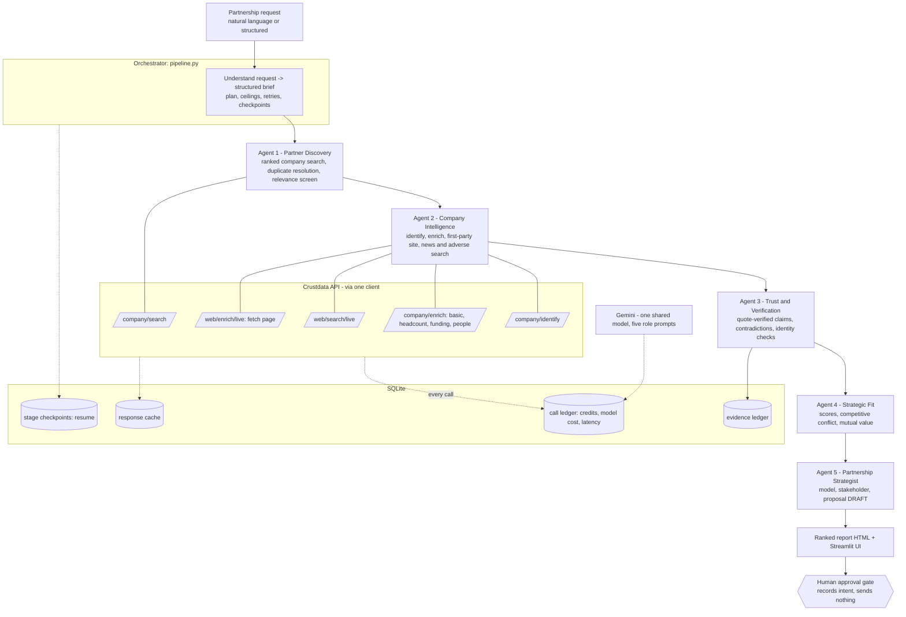

# PartnerScout architecture

Rules enforced in code, not just in prompts:

* A claim is **verified** only if its quote appears in the cited source text (`evidence.py`).
* Unknown is never zero: missing components are dropped and weights renormalised (`scoring.py`).
* Hard flags (identity unresolved, contradictions) override the numeric score.
* Every Crustdata and model call is logged; each run has a credit and a time ceiling.
* Every stage is checkpointed per (run, stage, item); a restart never repeats a paid call.
