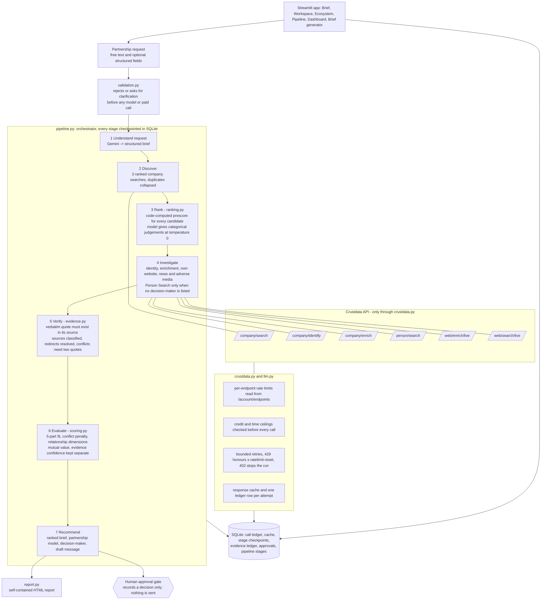

# PartnerScout architecture

The same architecture, technical and business, is on one editable draw.io page (link in the README). This file is the Mermaid version of the technical part.

Restart rule: `stage(run_id, stage, item, fn)` runs `fn` once per key and returns the stored output afterwards, so killing the process and starting it again with the same run id repeats no paid call.
